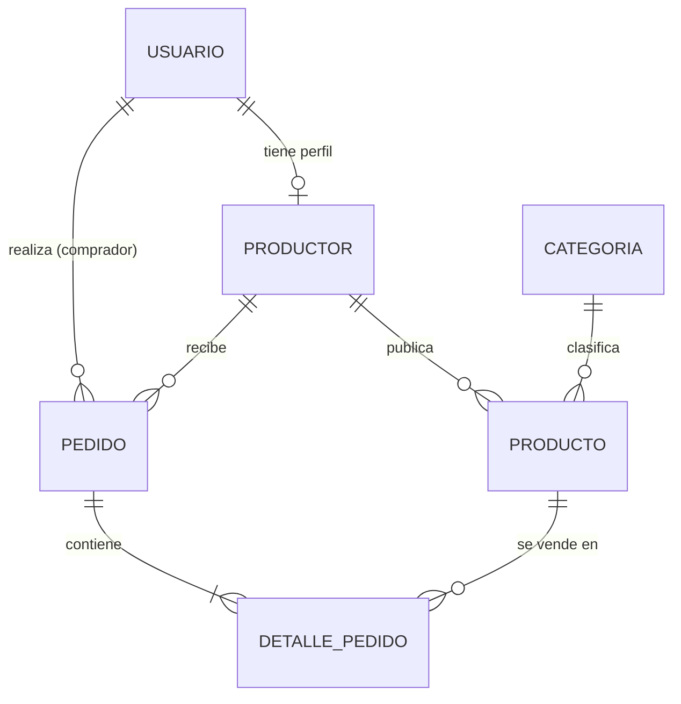

# Mercado Páramo

Plataforma de venta directa entre pequeños productores de Guasca (Cundinamarca) y compradores (consumidores, restaurantes y tiendas), **sin intermediarios**. El productor fija su propio precio y conserva el 95 % del valor de cada venta.

> Proyecto Integrador I (2026-2, IS G_02) – Ingeniería de Software, Universidad de La Salle.
> Contexto: plan de Ancestral Foundation, páramo de Chingaza (Guasca).

**Estado:** 🚧 En desarrollo. El diseño está definido; la implementación avanza por iteraciones (ver [Hoja de ruta](#hoja-de-ruta)).

---

## Problema

Los pequeños productores de Guasca reciben una baja participación en el precio final de sus productos porque dependen de intermediarios para llegar al comprador. Mercado Páramo les da un canal propio para publicar sus productos, recibir pedidos y medir cuánto del precio final queda en sus manos.

## Funcionalidades (MVP)

- Registro e inicio de sesión con roles: `ADMIN`, `PRODUCTOR`, `COMPRADOR` (JWT).
- Verificación de productores por parte de la fundación (`ADMIN`).
- Catálogo de productos con búsqueda por categoría, productor o nombre (paginado).
- Pedidos con validación y descuento de stock en una sola transacción.
- Flujo de estados del pedido: `PENDIENTE → ACEPTADO → ENTREGADO`, o `RECHAZADO` / `CANCELADO` (con devolución de stock).
- Reporte de ventas del productor e indicador de participación en el precio final.

**Fuera del alcance:** pagos en línea (pago contra entrega), logística de transporte, app móvil nativa y facturación electrónica.

## Reglas de negocio

| ID | Regla |
| --- | --- |
| RN-01 | Solo un productor `VERIFICADO` puede publicar productos. |
| RN-02 | El precio lo fija el productor y debe ser mayor que cero. |
| RN-03 | Un pedido contiene productos de un solo productor. |
| RN-04 | La plataforma retiene una comisión configurable del 5 %; el resto es ingreso neto del productor. |
| RN-05 | Un pedido solo se cancela en estado `PENDIENTE`; al cancelarse o rechazarse, el stock se devuelve. |

## Tecnologías

| Capa | Tecnología |
| --- | --- |
| Lenguaje y framework | Java 21, Spring Boot 3 (Web, Data JPA, Security, Validation) |
| Base de datos | PostgreSQL 16 (H2 en memoria para pruebas) |
| Seguridad | Spring Security + JWT, BCrypt |
| Documentación de la API | springdoc-openapi (Swagger UI) + Javadoc |
| Pruebas | JUnit 5, Mockito, Spring Boot Test, MockMvc, JaCoCo |
| Construcción | Maven, Docker, Docker Compose |

## Arquitectura

Arquitectura por capas con seguridad JWT transversal:

```
Cliente (web / móvil / Postman)
        │  HTTP + JSON + JWT
        ▼
JwtAuthFilter (Spring Security)
        ▼
Controller  →  Service  →  Repository (Spring Data JPA)  →  PostgreSQL
    │              │
GlobalExceptionHandler   Mappers entidad ↔ DTO
```

### Estructura del proyecto

```
mercado-paramo/
├── src/main/java/dev/nickbern/mercado_paramo/
│   ├── config/          SecurityConfig, OpenApiConfig
│   ├── security/        JwtService, JwtAuthFilter
│   ├── controller/      Auth, Productor, Producto, Pedido, Reporte
│   ├── service/         lógica de negocio
│   ├── repository/      interfaces Spring Data JPA
│   ├── model/           entidades y enums
│   ├── dto/             records de entrada y salida
│   └── exception/       excepciones de negocio + GlobalExceptionHandler
├── src/main/resources/application.yml
├── src/test/java/...    pruebas unitarias e integración
├── Dockerfile
└── docker-compose.yml
```

## Modelo de datos



`DETALLE_PEDIDO` guarda el precio unitario vigente al momento de la compra, para que un cambio posterior de precio no altere pedidos ya hechos. `PRODUCTO` usa `@Version` (bloqueo optimista) para evitar sobreventa con pedidos simultáneos.

## API (endpoints principales)

| Método | Ruta | Rol | Descripción |
| --- | --- | --- | --- |
| POST | `/api/auth/registro` | Público | Registrar usuario |
| POST | `/api/auth/login` | Público | Obtener JWT |
| PATCH | `/api/admin/productores/{id}/verificacion` | ADMIN | Verificar o rechazar productor |
| POST / PUT / DELETE | `/api/productos` | PRODUCTOR | Gestionar productos propios |
| GET | `/api/productos?categoria=&q=&page=` | Público | Catálogo paginado |
| POST | `/api/pedidos` | COMPRADOR | Crear pedido |
| PATCH | `/api/pedidos/{id}/estado` | PRODUCTOR / COMPRADOR | Cambiar estado del pedido |
| GET | `/api/reportes/ventas?desde=&hasta=` | PRODUCTOR | Reporte de ventas e indicador de participación |

Con la aplicación en ejecución, la documentación interactiva estará en `http://localhost:8080/swagger-ui.html`.

## Cómo ejecutar

### Requisitos

- Java 21
- Maven 3.9+ (o el wrapper `./mvnw` incluido)
- PostgreSQL 16 o Docker

### Variables de entorno

| Variable | Descripción | Ejemplo |
| --- | --- | --- |
| `DB_URL` | URL JDBC de PostgreSQL | `jdbc:postgresql://localhost:5432/mercado_paramo` |
| `DB_USER` | Usuario de la base de datos | `postgres` |
| `DB_PASSWORD` | Contraseña de la base de datos | — |
| `JWT_SECRET` | Clave para firmar los tokens (mín. 32 caracteres) | — |

### Ejecución local

```bash
git clone https://github.com/DevNico2905/mercado-paramo.git
cd mercado-paramo
./mvnw spring-boot:run
```

### Con Docker (planeado)

```bash
docker compose up
```

## Pruebas

```bash
./mvnw test      # pruebas unitarias e integración
./mvnw verify    # incluye reporte de cobertura JaCoCo
```

Meta de cobertura: ≥ 70 % en `PedidoService`. El protocolo completo (14 casos de prueba, CP-01 a CP-14) está en el documento del proyecto.

## Hoja de ruta

- [ ] **Iteración 1 – Base y seguridad:** modelo de datos, registro, login con JWT y roles.
- [ ] **Iteración 2 – Catálogo:** CRUD de productos, verificación de productores, búsqueda por categoría.
- [ ] **Iteración 3 – Pedidos:** creación de pedidos, validación de stock, flujo de estados y reporte de ventas.
- [ ] **Iteración 4 – Calidad y entrega:** pruebas, documentación Swagger, Docker y despliegue.

## Autor

**Nicolás Esteban Bernal Rodríguez** – Estudiante de Ingeniería de Software, Universidad de La Salle.
GitHub: [@DevNico2905](https://github.com/DevNico2905)
