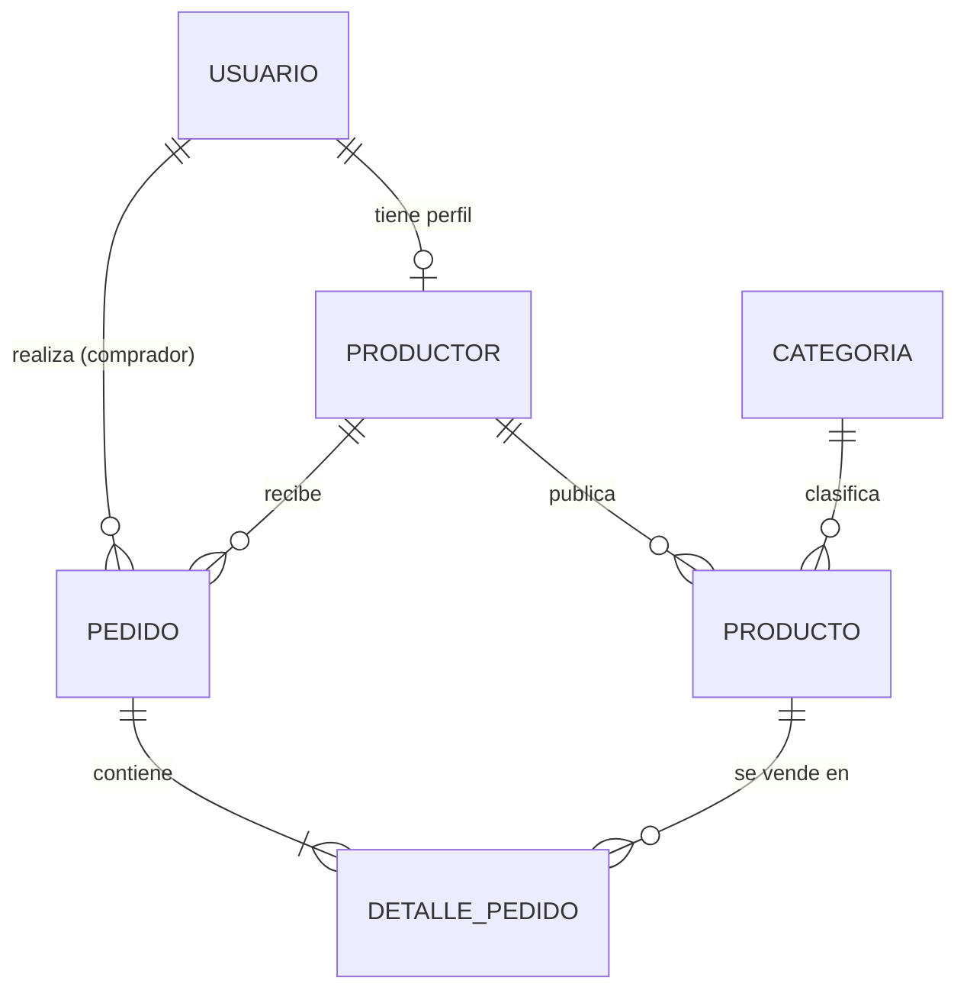

# Mercado Páramo

Plataforma de venta directa entre pequeños productores de Guasca (Cundinamarca) y compradores (consumidores, restaurantes y tiendas), **sin intermediarios**. El productor fija su propio precio y conserva el 95 % del valor de cada venta.

> Proyecto Integrador I (2026-2, IS G_02) – Ingeniería de Software, Universidad de La Salle.
> Contexto: plan de Ancestral Foundation, páramo de Chingaza (Guasca).

**Estado:** ✅ Backend del MVP completo (HU-01 a HU-08, 66 pruebas). 🚧 Frontend en desarrollo (ver [Hoja de ruta](#hoja-de-ruta)).

---

## Problema

Los pequeños productores de Guasca reciben una baja participación en el precio final de sus productos porque dependen de intermediarios para llegar al comprador. Mercado Páramo les da un canal propio para publicar sus productos, recibir pedidos y medir cuánto del precio final queda en sus manos.

## Funcionalidades (MVP)

- Registro e inicio de sesión con roles: `ADMIN`, `PRODUCTOR`, `COMPRADOR` (JWT).
- Verificación de productores por parte de la fundación (`ADMIN`).
- Catálogo público de productos con filtro por categoría y por productor.
- Pedidos con validación y descuento de stock en una sola transacción.
- Flujo de estados del pedido: `PENDIENTE → ACEPTADO → ENTREGADO`, o `RECHAZADO` / `CANCELADO` (con devolución de stock).
- Reporte de ventas del productor e indicador de impacto para la fundación (cuánto del precio final llega al productor).

**Fuera del alcance:** pagos en línea (pago contra entrega), logística de transporte, app móvil nativa y facturación electrónica.

## Reglas de negocio

| ID | Regla |
| --- | --- |
| RN-01 | Solo un productor `VERIFICADO` puede publicar productos. |
| RN-02 | El precio lo fija el productor y debe ser mayor que cero. |
| RN-03 | Un pedido contiene productos de un solo productor. |
| RN-04 | La plataforma retiene una comisión del 5 %; el 95 % restante es ingreso neto del productor. |
| RN-05 | Un pedido solo se cancela en estado `PENDIENTE`; al cancelarse o rechazarse, el stock se devuelve. |
| RN-06 | Cada productor o comprador solo puede modificar sus propios productos y pedidos. |

## Tecnologías

| Capa | Tecnología |
| --- | --- |
| Lenguaje y framework | Java 21, Spring Boot 4.1 (Web MVC, Data JPA, Security, Validation) |
| Base de datos | PostgreSQL 16 (H2 en memoria para pruebas) |
| Seguridad | Spring Security, JWT (jjwt), BCrypt |
| Documentación de la API | springdoc-openapi (Swagger UI con autenticación JWT) |
| Pruebas | JUnit 5, Mockito, Spring Boot Test, MockMvc |
| Construcción | Maven, Docker Compose (base de datos) |

## Arquitectura

Arquitectura por capas con seguridad JWT transversal:

```
Cliente (web / móvil / Postman)
        │  HTTP + JSON + JWT
        ▼
JwtAuthFilter (Spring Security)
        ▼
Controller  →  Service  →  Repository (Spring Data JPA)  →  PostgreSQL
    │              │
GlobalExceptionHandler   DTOs (records) con métodos de fábrica de(...)
```

### Estructura del proyecto

```
mercado-paramo/
├── src/main/java/dev/nickbern/mercado_paramo/
│   ├── config/          SecurityConfig (JWT, CORS, roles), OpenApiConfig, DataSeeder
│   ├── security/        JwtService, JwtAuthFilter, handlers 401/403
│   ├── controller/      Auth, Usuario, Catalogo, Pedido y los de Productor y Admin
│   ├── service/         lógica de negocio y reglas
│   ├── repository/      Spring Data JPA (@EntityGraph y JPQL con join fetch)
│   ├── model/           entidades y enums (EstadoPedido define las transiciones)
│   ├── dto/             records de entrada y salida
│   └── exception/       jerarquía NegocioException + GlobalExceptionHandler
├── src/main/resources/application.properties
├── src/test/java/...    pruebas unitarias, de slice e integración
└── docker-compose.yaml  PostgreSQL 16
```

## Modelo de datos



`DETALLE_PEDIDO` guarda el precio unitario vigente al momento de la compra, para que un cambio posterior de precio no altere pedidos ya hechos. `PRODUCTO` usa `@Version` (bloqueo optimista) para evitar sobreventa con pedidos simultáneos.

## API (endpoints principales)

| Método | Ruta | Rol | Descripción |
| --- | --- | --- | --- |
| POST | `/api/auth/registro` | Público | Registrar usuario (COMPRADOR o PRODUCTOR) |
| POST | `/api/auth/login` | Público | Obtener JWT |
| GET | `/api/usuarios/me` | Autenticado | Perfil del usuario actual |
| GET | `/api/categorias` | Público | Categorías |
| GET | `/api/productos?categoriaId=&productorId=` | Público | Catálogo |
| GET | `/api/productos/{id}` | Público | Detalle de producto |
| GET / POST | `/api/productor/productos` | PRODUCTOR | Listar o crear productos propios |
| PUT / DELETE | `/api/productor/productos/{id}` | PRODUCTOR | Editar o desactivar producto propio |
| GET / PATCH | `/api/productor/pedidos`, `/{id}/estado` | PRODUCTOR | Pedidos recibidos; aceptar, rechazar o entregar |
| GET | `/api/productor/reportes/ventas?desde=&hasta=` | PRODUCTOR | Reporte de ventas y participación |
| POST / GET | `/api/pedidos` | COMPRADOR | Crear pedido o listar los propios |
| PATCH | `/api/pedidos/{id}/cancelar` | COMPRADOR | Cancelar pedido pendiente |
| GET | `/api/admin/productores?estado=` | ADMIN | Listar productores |
| PATCH | `/api/admin/productores/{id}/verificacion` | ADMIN | Verificar o rechazar productor |
| GET | `/api/admin/reportes/impacto` | ADMIN | Indicador de impacto de la plataforma |

Documentación interactiva: `http://localhost:8080/swagger-ui.html`. Haz login, copia el `token` y pégalo en **Authorize** para probar los endpoints protegidos.

## Cómo ejecutar

### Requisitos

- Java 21
- Maven 3.9+ (o el wrapper `./mvnw` incluido)
- PostgreSQL 16 o Docker

### Variables de entorno

Crea un archivo `.env` en la raíz (ya está en `.gitignore`):

| Variable | Descripción | Ejemplo |
| --- | --- | --- |
| `DB_URL` | URL JDBC de PostgreSQL | `jdbc:postgresql://localhost:5432/mercado_paramo` |
| `DB_USER` | Usuario de la base de datos | `postgres` |
| `DB_PASSWORD` | Contraseña de la base de datos | — |
| `JWT_SECRET` | Clave en **Base64** de al menos 32 bytes | `openssl rand -base64 32` |
| `ADMIN_PASSWORD` | Contraseña del usuario ADMIN que se crea al arrancar | — |

### Ejecución local

```bash
git clone https://github.com/DevNico2905/mercado-paramo.git
cd mercado-paramo
docker compose up -d db      # PostgreSQL 16
./mvnw spring-boot:run
```

Al primer arranque se crean el usuario `admin@mercado-paramo.local` (con la contraseña de `ADMIN_PASSWORD`) y 5 categorías. Los datos persisten entre reinicios.

## Pruebas

```bash
./mvnw test
```

66 pruebas en tres niveles:

- **Unitarias** (Mockito): `JwtService`, `AuthService`.
- **De slice** (`@WebMvcTest`): formato estándar de errores (`GlobalExceptionHandler`).
- **De integración** (Spring completo, MockMvc, H2): flujos de autenticación, CORS, verificación de productores, catálogo, pedidos (stock, estados, IDOR) y reportes.

El protocolo de pruebas (CP-01 a CP-14) está en el documento del proyecto.

## Hoja de ruta

- [x] **Iteración 1 – Base y seguridad:** modelo de datos, registro, login con JWT y roles.
- [x] **Iteración 2 – Catálogo:** CRUD de productos, verificación de productores, filtro por categoría y productor.
- [x] **Iteración 3 – Pedidos:** creación con reserva de stock, flujo de estados, reporte de ventas e indicador de impacto.
- [ ] **Iteración 4 – Calidad y entrega:**
  - [x] Pruebas unitarias e integración (66)
  - [x] Documentación Swagger con JWT
  - [ ] Dockerfile de la aplicación y despliegue
- [ ] **Iteración 5 – Frontend web** a partir del contrato OpenAPI.

### Mejoras futuras

- Migraciones versionadas con Flyway (hoy `ddl-auto=update`).
- Paginación y búsqueda por nombre en el catálogo.
- Fecha de entrega propia del pedido para los reportes.
- Agregaciones del reporte en SQL para grandes volúmenes.
- Errores en formato RFC 9457 (`ProblemDetail`).

## Desarrollo asistido por IA

Este proyecto se desarrolló con Claude (IA de Anthropic) en el rol de tech lead: definió los tickets con criterios de aceptación, revisó cada Pull Request y, en la recta final del semestre, aportó buena parte del código. Mi trabajo fue implementar e integrar cada ticket, verificarlo con pruebas automatizadas y manuales, y depurar los errores reales que aparecieron en el camino. El flujo es el de un equipo profesional: una rama por ticket, Conventional Commits, PRs con revisión y una Definition of Done (pruebas en verde, sin secretos, sin código comentado).

## Autor

**Nicolás Esteban Bernal Rodríguez** – Estudiante de Ingeniería de Software, Universidad de La Salle.
GitHub: [@DevNico2905](https://github.com/DevNico2905)
